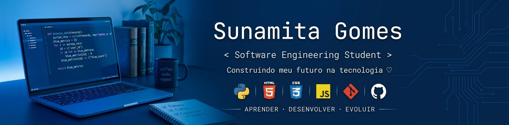

  

## Olá, mundo! ☕

Sou estudante de Engenharia de Software e profissional de tecnologia. Estou construindo minha jornada no desenvolvimento de software, unindo a prática diária na faculdade com a experiência prática do dia a dia.

---

## 💻 Sobre mim

* 🎓 **Formação:** Engenharia de Software — UNINTER.
* 💡 **Área de atuação:** Experiência em suporte técnico, atendimento e tecnologia.
* 🌱 **Atualmente:** Focada em aprofundar conhecimentos em lógica, bancos de dados, TypeScript e desenvolvimento front-end.
* 🎯 **Objetivo:** Construir soluções eficientes e evoluir constantemente na carreira tech.

---

## 🛠️ Tecnologias & Ferramentas

  

---

## 🚀 Projetos em Destaque

* **[Projeto Landing Page](https://github.com/SunamitaG)** — Landing page desenvolvida para aplicação de conceitos fundamentais de HTML e CSS.
* **[Desafio-1](https://github.com/SunamitaG)** — Resolução de desafios práticos do módulo base de tecnologia.

---

## 📬 Conecte-se comigo

  
  

 

<i>"Aprender, desenvolver e evoluir. Construindo o futuro com pequenos passos. ♡"</i>

